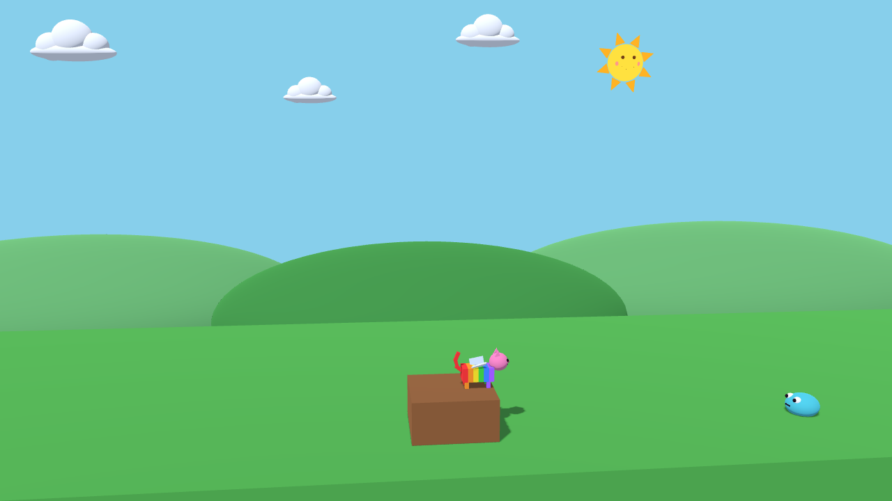
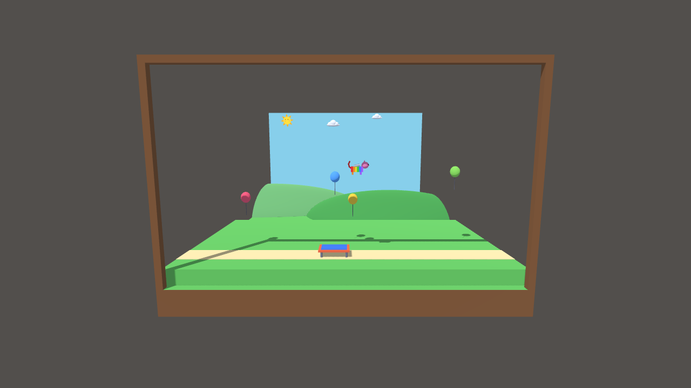

# kid-catgame-3d-ai

**English** | [Português](README.pt-br.md)

The cat game in 3D. It is a new version of
[kid-catgame-ai](https://github.com/RangelReale/kid-catgame-ai), the 2D platform game made by a father
and his 6-year-old daughter with help from Claude. The game uses the Godot 4.7 engine and runs
on Windows, Android, Mac and Meta Quest 3.

The cat still moves only sideways and up, as in the 2D game. The difference is
that everything is now made of 3D shapes, with light and shadow, and the camera
is tilted a little to show depth. All 16 levels of the 2D game are done, from
the lawn to the amusement park.

To play, run `godot --path .` at the repository root. Walk with the arrow keys
or with A and D, and jump with the space bar. Press jump again in the air to
flap the wings. A gamepad also works. The details are in the
[document index](docs-en/README.md).

## Meta Quest 3

On the Meta Quest 3, the level becomes a diorama that stands in the room: a
wooden box with the level inside and the sky painted on the back. The picture
shows the diorama on a computer screen, with `godot --path . -- --xr-preview`.
The details are in [Virtual reality](docs-en/04-virtual-reality.md).

## Languages and AI

The documents exist in English ([docs-en](docs-en/README.md)) and in Brazilian
Portuguese ([docs-pt-br](docs-pt-br/README.md)). When you change one, change
the other.

Conversations with AI assistants in this repository (Claude and others) stay
in Brazilian Portuguese. This way the daughter can keep asking for changes to
the game. The rules for the AI are in [CLAUDE.md](CLAUDE.md).
